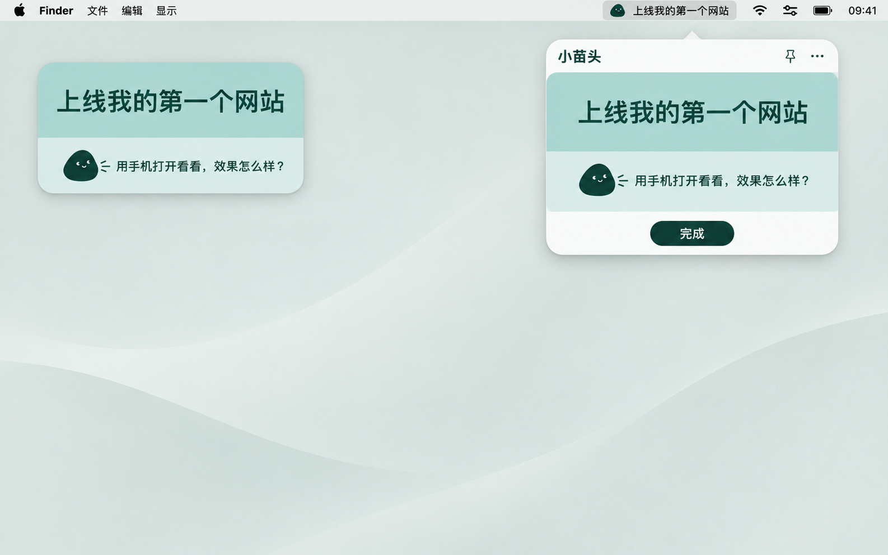
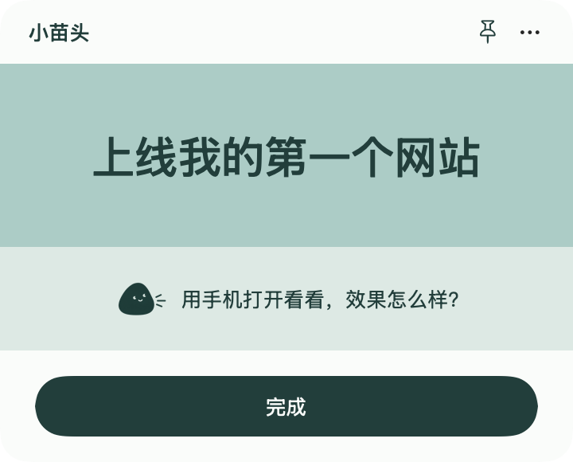
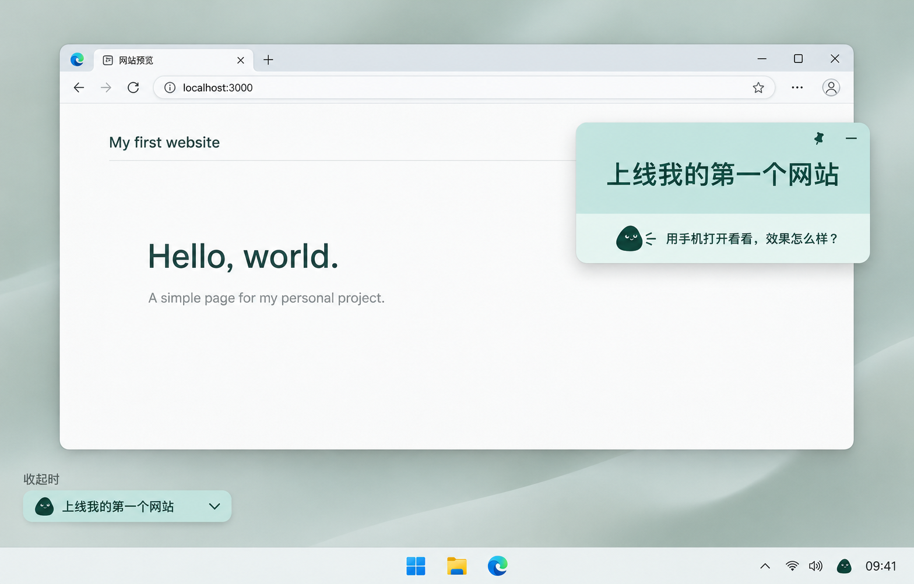

# 小苗头 · Miaotou Desktop

**只记一件自己想做的事，让它每天都看得见。**

小苗头是一个极简桌面应用，适合正在做副业、独立开发、写作或个人作品的人。把「上线第一个网站」「写完第一篇文章」这样的一件事，放在 Mac 菜单栏或 Windows 悬浮卡片里。小家伙每天给你一个小主意；做完以后，陪你庆祝。

[下载预览版](https://github.com/XiaoshengChen/miaotou-desktop/releases) · [反馈问题](https://github.com/XiaoshengChen/miaotou-desktop/issues)

## 它能帮你做什么

- 工作窗口铺满时，仍然记得自己真正想做的那件事。
- 觉得事情太大时，从小家伙的一句话里找一个可以开始的动作。
- 每次只保留一个方向；换一件时，原来的事项会留在历史里。
- 完成后看一场小烟花，再决定下一件想做的事。

不需要建立清单、项目、标签或优先级。

## 看起来是什么样

### Mac：菜单栏和固定卡片

下面是界面方向示意图，并非实际桌面截图。左侧展示桌面呈现，右侧展示菜单栏展开的卡片；当前预览版实现菜单栏、固定悬浮卡片与收起细条。



实际原生界面渲染：

<p></p>
<p></p>

### Windows：置顶卡片和托盘

下面是 Windows 设计示意图。卡片可以浮在普通工作窗口上方；忙碌时收成一条，暂时隐藏后可以从托盘找回来。



## 开始使用

### Mac

系统要求：macOS 14 或更新版本，支持 Apple 芯片与 Intel。

1. 从 [Releases](https://github.com/XiaoshengChen/miaotou-desktop/releases) 下载 Mac 预览包并解压，把「小苗头.app」放进 Applications。
2. 打开应用，在菜单栏输入一件事，点击 **Save this / 写好了**。
3. 点图钉，把卡片固定在桌面；点横线收成细条。
4. 完成后点 **Done / 完成**，查看庆祝，再写下一件。

默认界面为 English，可在 More → Preferences 中切换简体中文。预览包采用本地签名，尚未完成 Developer ID 公证，也未在 Mac App Store 发布；不适合替代正式签名分发，开发者可从源码构建。

### Windows

当前提供 Windows 11 x64 预览包，内置运行环境，无需另装 .NET。

1. 从 [Releases](https://github.com/XiaoshengChen/miaotou-desktop/releases) 下载 Windows 包并解压。
2. 运行 `Miaotou.exe`，写好一件事。
3. 拖动卡片调整位置；点击事项展开「完成」；横线可收起为细条。
4. 右下角系统托盘里的小家伙可以恢复卡片。右键可打开历史、偏好设置或退出。

预览包尚未做代码签名。核心记录逻辑与编译已验证，窗口、托盘和多显示器体验仍需要更多 Windows 真机反馈。

## 小家伙的话从哪里来

Mac 在系统支持 Apple Intelligence、端侧模型可用且支持所选语言时，尝试在本机生成简短主意；其余时候使用内置的离线内容。Windows 当前使用离线内容。每天按本地日期更换一句，不调用云端 AI 服务，不需要 API key。

内容可以是一条具体建议、一个有用的问题，或者一句轻松的提醒。没有给名人编造引语。端侧生成质量仍需要兼容设备上的持续测试。

## 记录与隐私

- 无账号、广告、分析追踪或云端数据上传。
- 事项、历史和偏好保存在当前电脑。
- **Mac、Windows 与手机之间暂未自动同步。**桌面版可导出、导入 JSON 记录；导入替换前会先备份现有记录。
- 登录后启动由用户在偏好设置中主动开启。
- 仓库只包含应用源码、通用示例和必要图片，不包含实际事项、开发者账号、证书或 API 密钥。

## 从源码构建

### Mac

需要能编译 Foundation Models API 的 Xcode 26 或更新版本，以及 Python 3。模型本身在不兼容设备上会自动回退。

```sh
swift test --package-path Mac
zsh Mac/build-app.sh
```

通用 App 和 ZIP 生成在 `dist/`。默认使用公开的通用 bundle identifier；自己的分发身份可在本地构建配置中调整，不要提交签名材料。

### Windows

需要 .NET 10 SDK。在 Windows PowerShell 中运行：

```powershell
dotnet run --project Windows/Smoke/Smoke.csproj
powershell -File Windows/build.ps1
```

程序生成在 `dist/windows-x64/`。也可在 Mac/Linux 上交叉编译；这不能代替 Windows 真机交互验收。

## 项目结构

```text
Mac/                       SwiftUI / AppKit 应用与核心测试
Windows/                   WPF 应用、托盘入口与核心检查
docs/images/               示意图与原生界面渲染
scripts/                   公开发布前的敏感信息检查
.github/workflows/         Mac / Windows 构建检查
```

当前版本专注于一件事、持续可见、每日一点主意和完成反馈。欢迎通过 Issue 分享具体使用场景或可复现的问题。
